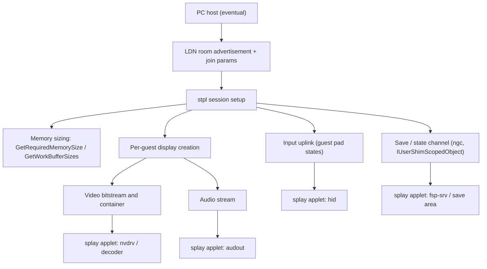

# Dossier — GameShare / `splay`, PC-hosted receiver surface

Tier C on score, reserve on strategy. The only no-content, host-driven entry in the matrix.

## 1. Reframing

GameShare is not DS Download Play. It is remote play.

A Switch 2 runs the game and streams a per-guest view to a receiver. The receiver is a stock Switch 1 or Switch 2 running the `splay` applet — a thin client with an unusually wide service set for an applet: `fsp-srv`, `ldn`, `nifm`, `bsd`, `nvdrv`, `audout`, `audren`, `hid:sys`, `stpl:sys`. No download, no install, no cartridge on the guest. The session dies with the session.

That is interesting for one reason only: **the host is the attacker, and the host can eventually be a PC.**

If a PC can advertise the room, complete the join, and speak `stpl`, then GameShare becomes a one-target, offline-fuzzable parser that needs no game, no save, no modchip and no second console in the loop. The Switch 2 becomes a capture and confirmation device, not a permanent dependency.

The working thesis:

> The `splay` applet parses attacker-supplied session, media, input and possibly save/state data on a stock 23.0.1 Switch 1, and nobody has fuzzed it.

The corollary, which is the actual bet: **resource pressure from the media channel can widen or expose a bug in the save/state channel.** Flooding alone is unlikely to be a bug. Flooding as an allocator and timing lever against a concurrent save write is a real hypothesis.

## 2. What is verified

| Claim | Status | Source |
| --- | --- | --- |
| Only Switch 2 can host; any Switch 1 or 2 can receive locally | VERIFIED | Nintendo GameShare page |
| Switch 1 cannot host and cannot receive online | VERIFIED | Same |
| No download; host runs and streams the game | VERIFIED | Nintendo page; Sensatez teardown; Verge hands-on |
| Host renders a separate view per guest, letterboxed to ~80% screen, some titles cap 30 fps | VERIFIED | Sensatez |
| Up to three guests, split controls across players | VERIFIED | Verge |
| Session-only; nothing persists | VERIFIED | Nintendo page |
| Switch 1 `splay` applet exists on 23.0.1 and invokes `stpl:sys` | VERIFIED | `borntohonk/Switch-Ghidra-Guides`, `ipc_json_dumps/ns1/23.0.1/applets/splay.json` |
| `splay` holds `fsp-srv`, `ldn:s/u`, `nifm`, `bsd`, `hid:sys`, `audout/audren`, `nvdrv` | VERIFIED | Same service list |
| Switch 2 has a distinct `SplayApplet` with `chat:sp`, `lp2p`, `lrp`, `nsd`, `ssl`, `nvdrv:s/t` | VERIFIED | Same repo, `ns2/23.0.1/applets/SplayApplet.json` |
| `nn::streamplay` exposes `GetRequiredMemorySize`, `GetWorkBufferSizes`, `CreateIndividualDisplays`, `GetGuestPadStates`, `WriteGuestAudioStream` | VERIFIED | Emulator HLE and SDK stub code |
| `NGC_services` exposes content check/mask/match and save-slot read/write | VERIFIED | `NGC_services.json`, `IUserShimScopedObject` commands 450–457 |
| No public GameShare/`splay` exploit or dedicated research repo | VERIFIED (absence) | GitHub search, issues, CVE trackers |
| 23.0.0 changed `splay` NPDM and RomFS; 23.0.1 changed only `sdb` | PARTIAL | TX10LED read-only review |

No public work means no prior art to copy and no known-negative to inherit. It also means the protocol grammar is undocumented outside Nintendo and the emulator stubs.

## 3. Hypotheses, each falsifiable

| ID | Hypothesis | If false |
| --- | --- | --- |
| H-GS1 | The guest applet receives and parses save/state metadata, not only media | The save-flood half dies; media remains |
| H-GS2 | A PC can satisfy room advertisement and join enough to get `splay` launched on the guest | PC hosting is blocked behind a real Switch 2 indefinitely |
| H-GS3 | The stream uses standard codec/container parameters a PC can generate | Need a host-side encoder dump or a Switch 2 proxy |
| H-GS4 | Guest-count, bitrate, frame-size or audio pressure changes allocator/timing enough to make a save bug reachable | Flood is cosmetic; fuzz the channels independently |
| H-GS5 | The Switch 1 guest path is a compatibility subset, not a Switch 2-only feature | Only Switch 2 guests are reachable, which is still useful but not the target |

H-GS1 and H-GS2 are the load-bearing ones. Answer them before writing an encoder.

## 4. Surface, ordered by reachability

| # | Surface | Attacker control | Likely class |
| --- | --- | --- | --- |
| 1 | Room advertisement and join parameters | Full | Length/count mismatch, state machine |
| 2 | `stpl:sys` setup and capability negotiation | Full | Trusted host-supplied sizes |
| 3 | Guest count and work-buffer sizing | Full | Integer overflow, under-allocation |
| 4 | Display creation and teardown | Full | Handle lifetime, double-destroy |
| 5 | Video container/bitstream | Full | Parser OOB, decoder ring overflow |
| 6 | Audio stream parameters and frames | Full | Count/rate arithmetic |
| 7 | Guest input state | Host reads, guest supplies | Malformed HID state |
| 8 | Save slot read/write/commit | Full if host-side | Buffer, path, commit/read race |
| 9 | Applet launch args and error paths | Full | Arg parsing, teardown on error |

### Why the memory-sizing path matters

`GetRequiredMemorySize` returns a page count derived from a host-supplied guest count; `GetWorkBufferSizes` returns four `u64` values for a global and three per-guest parts. The SDK derives the guest count by dividing the allocated buffer by the per-guest requirement, clamped to three. A host that lies about either side controls an allocation and a subsequent index. That is the cheapest early surface and it needs no codec.

### Why the save channel matters

`IUserShimScopedObject` 452–457 is a save-slot API: `OpenSaveData`, `CloseSaveData`, `ReadSaveSlot`, `WriteSaveSlot`, `FlushSaveSlot`, `CommitSaveData`. `ngc` adds content version checks and match/filter. The guest applet holds `fsp-srv`, so it can stage and commit the result.

If the guest writes host-supplied save data into its own applet save, that is a second parser with persistent state and a commit boundary — a much better bug site than a frame buffer. **INFERRED, not verified.** H-GS1 exists to settle it.

## 5. The dual-stream hypothesis

Two attacker-controlled channels, deliberately crossed:

- **Media pressure.** Guest count, resolution, bitrate, frame size, slice count, IDR cadence, audio sample rate and frames per packet.
- **Save pressure.** Slot size, metadata, file count, and the timing of `WriteSaveSlot`/`CommitSaveData` relative to decode.

Mechanisms worth testing, in order:

1. **Guest count above three.** The UI offers three, but the host supplies the number and the buffer. Over-index the per-guest arrays.
2. **Sizing contradiction.** Allocate for one guest, claim another; swap type 0 and type 1 requirements; send work-buffer sizes that disagree with the allocation.
3. **Frame-size spike during a commit.** Max-size keyframe while a save write is in flight, to move the allocator under the save copy.
4. **Audio frame inflation.** Channels × frames × sample size is a cheap multiply to overflow in a fixed work buffer.
5. **Commit/read race.** `CommitSaveData` while the applet still holds a read handle, or a second `OpenSaveData` before the first close.
6. **Teardown under load.** Destroy displays and close the session mid-transfer; check error unwind.

A win is any of: decoder-ring overflow, save-buffer OOB, `fsp` path/metadata bug, or a deterministic UAF from commit/teardown ordering.

**Falsification:** if the save channel turns out to be host-side only and the guest never sees save bytes, H-GS1 is false and only media survives. That is still a fuzzable surface, but the dual-stream story collapses.

## 6. Host-role ladder

Each gate is a pass/fail with a concrete observation. Do not build past a failed gate.

| Gate | Pass condition | Why it can fail |
| --- | --- | --- |
| G0 — capture | A real local session between a Switch 2 host and the OLED guest is captured end to end | Nothing to replay without it |
| G1 — room replay | PC advertises the captured room; the OLED shows the room and the accept prompt | `ldn` room crypto or beacon shape |
| G2 — launch | Guest accepts; `splay` launches and reaches its first network state | Applet launch needs more than a room |
| G3 — session | PC completes `stpl:sys` setup and memory sizing; applet waits for media | Unknown command order |
| G4 — media replay | A recorded stream plays on the guest | Container has host-specific state |
| G5 — synthetic media | PC-generated frames and audio render; save channel accepted | Encoder or save format unknown |
| G6 — pressure | One-variable mutations produce a reproducible guest fault | No depth |

G1 is the real feasibility gate. TX10LED already reached association and AID 1 against a console using AP-mode injection, then lost it at `reason_code=8` before the LDN payload. That work is the starting point, not a solved problem: the current adapter (`rtw88_8822bu`) cannot transmit in monitor mode, and hostapd's beacon SSID shape differs from the `MonitorAP` path.

## 7. Dumps and tooling

Dumps are the substitute for a permanent modded Switch 2: the host role is learned offline from system and game binaries, then implemented on a PC. Minimum useful set, in order:

1. **Switch 2:** `SplayApplet`, `NGC_services`, the `stpl` sysmodule, and one GameShare-compatible game's `main`. The game gives host-side call order and structures; the system programs give the guest grammar.
2. **Switch 1 23.0.1:** `splay` NPDM and `main`. The program NCA is keygen `0x17` in the current dump and does not decrypt with the held key set.
3. **Public substitutes:** `borntohonk/Switch-Ghidra-Guides` already maps both applets' service lists, vtables and command stubs. Emulator HLE code documents `stpl:u` command 0, `GetRequiredMemorySize`, `GetWorkBufferSizes` and the `nn::streamplay` surface.
4. **ns2jb as a dumper:** if a Switch 2 is available, its firmware-dump path can capture accessible system programs and save the reverse-engineering step.

Tooling: Ghidra with the Switch loader, Wireshark with 802.11 support, the TX10LED LDN advertisement code for AES-CTR room parameters, and a packet-level diff harness once G1 passes.

## 8. Rig

- One stock Switch 2 and one compatible title. Borrow before buying. `Mario Odyssey`, `51 Worldwide Games`, `Captain Toad`, `Big Brain Academy` and `3D World` are the cheap physical options; digital works too.
- OLED as guest. GameShare is session-only, so brick risk is low, but the OLED is still the daily driver.
- Controlled 2.4 GHz channel, quiet air, MAC randomisation off, 90DNS on both consoles so the firmware cannot move.
- Capturing radio with working monitor-mode TX. The ESP32-S3 is the current injector plan; a known-good Linux adapter is the fallback. AP mode alone gets beacons but not the vendor action frames.
- Capture on the air only. There is no debug channel on the guest and no `twili` on the OLED.

## 9. Known-unknowns

Tracked as Q26–Q32 in `07-open-questions.md`:

- Whether the guest ever receives save/state data, and through which interface.
- Whether the stream is a standard container or a Nintendo-private framing.
- Whether the guest system launches `splay` from room parameters alone.
- Whether `GetRequiredMemorySize` trusts a host guest count above three.
- Which `stpl:sys` commands are reachable before a session exists.
- Whether the Switch 1 guest is a compatibility subset of the Switch 2 protocol.
- Whether a PC can complete the join with AP-mode-only injection.

## 10. First three experiments

1. **Capture one real session.** Switch 2 host, OLED guest, one title, controlled channel. Record every frame from advertisement to teardown; log the exact guest prompts, applet launch time and error codes. Deliverable: a pcap and a timeline.
2. **Map the guest statically.** Take `splay` NPDM and `main` from 23.0.1, index it against the public IPC dump, and list the `stpl:sys` commands actually called, in order. Deliverable: call table with argument shapes.
3. **Room replay from a PC.** Replay the captured advertisement and association with the TX10LED machinery, no Switch 2 present. Deliverable: pass/fail on G1, with the first divergence point.

Only experiment 3 needs the injecting radio. Experiments 1 and 2 can start with borrowed hardware and dumps.

## 11. What counts as a win

| Tier | Result | Note |
| --- | --- | --- |
| T0-adjacent | Applet code execution or controlled write through `splay` | Needs an applet→something pivot to be useful; `fsp-srv` gives save read/write, `ldn` gives radio, `bsd` gives a beacon |
| T0 | Session-only loader or applet-save editor via GameShare | No cartridge, no save install, host-driven; a PC host can serve a synthetic stream, not a real game |
| T3 contribution | PC host removes the Switch 2 requirement | Social friction only: be in range and accept |

It is not a kernel path. Do not score it as one. It is a delivery channel with a parser behind it.

## 12. Status and kill criteria

**Reserve.** Start only if a tier-A track dies, a Switch 2 is borrowable, or the `fsp` track needs a no-cartridge delivery story.

- **Kill 1:** no G1 after four weeks of radio work → park; the room crypto is the wall.
- **Kill 2:** six weeks from G1 with no deterministic guest fault → park and publish the negative.
- **Kill 3:** stream turns out opaque and no PC encoder is feasible → park until a host-side dump exists.
- **Kill 4:** guest `splay` is a thin passthrough to `nvdrv`/`codec` with no Nintendo-written parsing → rotate to the codec.

Publish the pcap, the room parameters and the command table even on a kill. The next person should not repeat G0.

## 13. Legal posture

Own dumps, own captures, no copyrighted blobs committed. GameShare is a normal user feature; reverse-engineering the wire format is the same posture as the rest of the programme. No console ban risk beyond the usual offline-testing hygiene.
