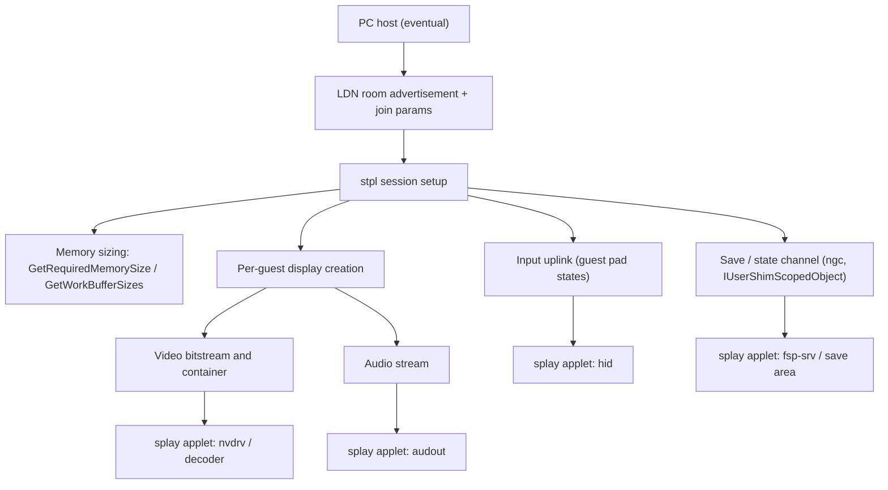

# Dossier — GameShare / `splay`, host-side receiver surface

Tier C on score, reserve on strategy. The only no-content, host-driven entry in the matrix.

## 1. Reframing

GameShare is not DS Download Play. It is remote play.

A Switch 2 runs the game and streams a per-guest view to a receiver. The receiver is a stock Switch 1 or Switch 2 running the `splay` applet — a thin client with an unusually wide service set for an applet: `fsp-srv`, `ldn`, `nifm`, `bsd`, `nvdrv`, `audout`, `audren`, `hid:sys`, `stpl:sys`. No download, no install, no cartridge on the guest. The session dies with the session.

That is interesting for one reason only: **the host is the attacker, and the host can eventually be a PC.**

First the v1 proves the host role. Then a PC can take it over: advertise the room, complete the join, speak `stpl`. At that point GameShare becomes a one-target, offline-fuzzable parser that needs no game, no save, no modchip and no second console in the loop. The Switch 2 becomes a capture and confirmation device, not a permanent dependency.

The working thesis:

> The `splay` applet parses attacker-supplied session, media, input and possibly save/state data on a stock 23.0.1 Switch 1, and nobody has fuzzed it.

The first target is not the PC. A 23.0.1 Switch 1 already contains the host program (`NGC_services`, title `0100000000000050`) and the guest applet (`splay`, title `0100000000001048`). Both are dormant, not absent. The v1 can be the host before any PC work: prove the host role there, then port it. See `11-gameshare-host-bringup.md`.

Only after that does the PC question matter. If the v1 can host, a PC can be taught to host.

The corollary, which is the actual bet: **resource pressure from the media channel can widen or expose a bug in the save/state channel.** Flooding alone is unlikely to be a bug. Flooding as an allocator and timing lever against a concurrent save write is a real hypothesis.

## 2. What is verified

| Claim | Status | Source |
| --- | --- | --- |
| Only Switch 2 can host; any Switch 1 or 2 can receive locally | VERIFIED | Nintendo GameShare page |
| Switch 1 cannot host and cannot receive online | VERIFIED | Same |
| No download; host runs and streams the game | VERIFIED | Nintendo page; Sensatez teardown; Verge hands-on |
| Host renders a separate view per guest, letterboxed to ~80% screen, some titles cap 30 fps | VERIFIED | Sensatez |
| Up to three guests, split controls across players | VERIFIED | Verge |
| Session-only; nothing persists | VERIFIED | Nintendo page |
| Switch 1 `splay` applet exists on 23.0.1 and invokes `stpl:sys` | VERIFIED | `borntohonk/Switch-Ghidra-Guides`, `ipc_json_dumps/ns1/23.0.1/applets/splay.json` |
| `splay` holds `fsp-srv`, `ldn:s/u`, `nifm`, `bsd`, `hid:sys`, `audout/audren`, `nvdrv` | VERIFIED | Same service list |
| Switch 2 has a distinct `SplayApplet` with `chat:sp`, `lp2p`, `lrp`, `nsd`, `ssl`, `nvdrv:s/t` | VERIFIED | Same repo, `ns2/23.0.1/applets/SplayApplet.json` |
| `nn::streamplay` exposes `GetRequiredMemorySize`, `GetWorkBufferSizes`, `CreateIndividualDisplays`, `GetGuestPadStates`, `WriteGuestAudioStream` | VERIFIED | Emulator HLE and SDK stub code |
| `NGC_services` exposes content check/mask/match and save-slot read/write | VERIFIED | `NGC_services.json`, `IUserShimScopedObject` commands 450–457 |
| No public GameShare/`splay` exploit or dedicated research repo | VERIFIED (absence) | GitHub search, issues, CVE trackers |
| 23.0.0 changed `splay` NPDM and RomFS; 23.0.1 changed only `sdb` | PARTIAL | TX10LED read-only review |
| `NGC_services` is a system program on 23.0.1 and provides `stpl:u/sys`, `ngc:u/ngct:u` | VERIFIED | `NGC_services.json`, title map |
| `splay` is `0100000000001048`, new in 22.0.0, and invokes `stpl:sys` | VERIFIED | `process_swipc.py`, `splay.json` |
| `fsp` has `EncryptStreamPlaySaveData` (830) and `DecryptStreamPlaySaveData` (831) | VERIFIED | `Filesystem_services.json` |
| `pctl` has StreamPlay free-communication gates; `hid` has Splay connection triggers | VERIFIED | `Parental_Control_services.json`, `HID_services.json` |
| `ldn` exposes `OpenAccessPoint`, `CreateNetwork`, `SetAdvertiseData`, `EnableActionFrame` | VERIFIED | `LDN_services.json` 200–208, 500 |

No public work means no prior art to copy and no known-negative to inherit. It also means the protocol grammar is undocumented outside Nintendo and the emulator stubs.

## 3. Hypotheses, each falsifiable

| ID | Hypothesis | If false |
| --- | --- | --- |
| H-GS0 | A modded Switch 1 can host the protocol: launch `NGC_services`, register `stpl`, and get `splay` launched on a stock guest | PC work is gated behind a Switch 2 again; park or fall back to a real capture |
| H-GS1 | The guest applet receives and parses save/state metadata, not only media | The save-flood half dies; media remains |
| H-GS2 | A PC can satisfy room advertisement and join after the v1 proves the protocol | PC hosting is blocked; v1 hosting remains usable |
| H-GS3 | The stream uses standard codec/container parameters a PC can generate | Need a host-side encoder dump or a Switch 2 proxy |
| H-GS4 | Guest-count, bitrate, frame-size or audio pressure changes allocator/timing enough to make a save bug reachable | Flood is cosmetic; fuzz the channels independently |
| H-GS5 | The Switch 1 guest path is a compatibility subset, not a Switch 2-only feature | Only Switch 2 guests are reachable, which is still useful but not the target |

H-GS0, H-GS1 and H-GS2 are the load-bearing ones. H-GS0 is answered by `11-gameshare-host-bringup.md` before any encoder exists.

## 4. Surface, ordered by reachability

| # | Surface | Attacker control | Likely class |
| --- | --- | --- | --- |
| 1 | Room advertisement and join parameters | Full | Length/count mismatch, state machine |
| 2 | `stpl:sys` setup and capability negotiation | Full | Trusted host-supplied sizes |
| 3 | Guest count and work-buffer sizing | Full | Integer overflow, under-allocation |
| 4 | Display creation and teardown | Full | Handle lifetime, double-destroy |
| 5 | Video container/bitstream | Full | Parser OOB, decoder ring overflow |
| 6 | Audio stream parameters and frames | Full | Count/rate arithmetic |
| 7 | Guest input state | Host reads, guest supplies | Malformed HID state |
| 8 | Save slot read/write/commit | Full if host-side | Buffer, path, commit/read race |
| 9 | Applet launch args and error paths | Full | Arg parsing, teardown on error |

### Why the memory-sizing path matters

`GetRequiredMemorySize` returns a page count derived from a host-supplied guest count; `GetWorkBufferSizes` returns four `u64` values for a global and three per-guest parts. The SDK derives the guest count by dividing the allocated buffer by the per-guest requirement, clamped to three. A host that lies about either side controls an allocation and a subsequent index. That is the cheapest early surface and it needs no codec.

### Why the save channel matters

`IUserShimScopedObject` 452–457 is a save-slot API: `OpenSaveData`, `CloseSaveData`, `ReadSaveSlot`, `WriteSaveSlot`, `FlushSaveSlot`, `CommitSaveData`. `ngc` adds content version checks and match/filter. The guest applet holds `fsp-srv`, so it can stage and commit the result.

If the guest writes host-supplied save data into its own applet save, that is a second parser with persistent state and a commit boundary — a much better bug site than a frame buffer. **INFERRED, not verified.** H-GS1 exists to settle it.

## 5. The dual-stream hypothesis

Two attacker-controlled channels, deliberately crossed:

- **Media pressure.** Guest count, resolution, bitrate, frame size, slice count, IDR cadence, audio sample rate and frames per packet.
- **Save pressure.** Slot size, metadata, file count, and the timing of `WriteSaveSlot`/`CommitSaveData` relative to decode.

Mechanisms worth testing, in order:

1. **Guest count above three.** The UI offers three, but the host supplies the number and the buffer. Over-index the per-guest arrays.
2. **Sizing contradiction.** Allocate for one guest, claim another; swap type 0 and type 1 requirements; send work-buffer sizes that disagree with the allocation.
3. **Frame-size spike during a commit.** Max-size keyframe while a save write is in flight, to move the allocator under the save copy.
4. **Audio frame inflation.** Channels × frames × sample size is a cheap multiply to overflow in a fixed work buffer.
5. **Commit/read race.** `CommitSaveData` while the applet still holds a read handle, or a second `OpenSaveData` before the first close.
6. **Teardown under load.** Destroy displays and close the session mid-transfer; check error unwind.

A win is any of: decoder-ring overflow, save-buffer OOB, `fsp` path/metadata bug, or a deterministic UAF from commit/teardown ordering.

**Falsification:** if the save channel turns out to be host-side only and the guest never sees save bytes, H-GS1 is false and only media survives. That is still a fuzzable surface, but the dual-stream story collapses.

## 6. Host-role ladder

Two ladders. **Phase A (v1 host)** comes first and needs no Switch 2; **Phase B (PC host)** only starts after A3. Full detail is in `11-gameshare-host-bringup.md`; the summary:

| Gate | Pass condition | Why it can fail |
| --- | --- | --- |
| A0 — static map | Every `stpl` command has a named implementation and caller; `splay` launch condition identified | NCA or key access |
| A1 — services | `stpl:sys`, `stpl:u`, `ngc:u`, `ngct:u` open and answer after launching `NGC_services` | NPDM permissions or a platform gate |
| A2 — room | The OLED scan list shows the room with the right metadata | `ldn` parameter or crypto mismatch |
| A3 — launch | Guest accepts; `splay` launches and reaches its first network state | Applet launch needs more than a room |
| A4 — session | Host drives `stpl:sys` setup; applet waits for media | Unknown command order |
| A5 — media/save | One frame renders; one save slot commits | Encoder or save format unknown |

A3 is the real feasibility gate, not A2. A room that appears and is rejected is a field problem; a room that launches `splay` is a host.

Phase B is the same ladder with the PC as host, renumbered B0–B6. It begins with a capture of the working A3 session and removes the v1 from the loop. TX10LED's `reason_code=8` and monitor-TX work is the starting point for B1, not a solved problem.

## 7. Dumps and tooling

Phase A needs the v1, not a Switch 2. Minimum useful set, in order:

1. **Switch 1 23.0.1:** `NGC_services`, `splay`, `ldn`, `lp2p`, `fsp`, `hid`, `pctl`. The v1 can dump all of them; derive `0x17` keys with `Lockpick_RCM` and a current key generator.
2. **Switch 2, later:** `SplayApplet`, `stpl`, and one GameShare-compatible game's `main`. Only needed for Phase B and for a byte-for-byte room diff.
3. **Public substitutes:** `borntohonk/Switch-Ghidra-Guides` already maps both applets' service lists, vtables and command stubs. Emulator HLE code documents `stpl:u` command 0, `GetRequiredMemorySize`, `GetWorkBufferSizes` and the `nn::streamplay` surface.
4. **ns2jb as a dumper:** if a Switch 2 is borrowed, its firmware-dump path captures accessible system programs.

Tooling: Ghidra with the Switch loader, `twili`/`dmnt` on the v1, Wireshark with 802.11 support, and the TX10LED LDN advertisement code for AES-CTR room parameters.

## 8. Rig

- **v1 as host.** CFW, 23.0.1, dumped and golden-imaged. It is the only console the host code runs on in Phase A.
- **OLED as guest.** Stock, 23.0.1. GameShare is session-only, so brick risk is low, but the OLED is still the daily driver.
- **No Switch 2.** It is borrowed only if A3 fails and a real room diff is needed.
- Controlled 2.4 GHz channel, quiet air, MAC randomisation off, 90DNS on both consoles so the firmware cannot move.
- `twili`/`dmnt` trace on the host; air capture for the guest. There is no debug channel on the OLED.

## 9. Known-unknowns

Tracked as Q26–Q35 in `07-open-questions.md`:

- Whether `NGC_services` can be launched on a v1 and register `stpl`/`ngc`.
- Whether the guest ever receives save/state data, and through which interface.
- Whether the stream is a standard container or a Nintendo-private framing.
- Whether the guest system launches `splay` from room parameters alone.
- Whether `GetRequiredMemorySize` trusts a host guest count above three.
- Which `stpl:sys` commands are reachable before a session exists.
- Whether the Switch 1 guest is a compatibility subset of the Switch 2 protocol.
- Whether a PC can complete the join only after the v1 has proved it.

## 10. First three experiments

1. **Static map the v1.** Extract `NGC_services`, `splay` and `ldn`, and list every `stpl` command with its caller and direction. Deliverable: call table and NPDM permissions.
2. **Probe the services.** `smGetService` all four; launch `NGC_services` by title if absent; trace it. Deliverable: registration result and a startup trace.
3. **Build the room.** Call `ldn` host APIs with the traced parameters and watch the OLED scan list. Deliverable: pass/fail on A2 and A3, with the first divergence point.

None of these needs a Switch 2 or an injecting radio. Phase B does.

## 11. What counts as a win

| Tier | Result | Note |
| --- | --- | --- |
| T0-adjacent | Applet code execution or controlled write through `splay` | Needs an applet→something pivot to be useful; `fsp-srv` gives save read/write, `ldn` gives radio, `bsd` gives a beacon |
| T0 | Session-only loader or applet-save editor via a v1-hosted GameShare session | No cartridge, no save install, host-driven |
| T3 contribution | PC host removes the v1 as well | Social friction only: be in range and accept |

A3 alone — a v1-hosted room that launches `splay` on a stock guest — is a publishable milestone even with no bug.

It is not a kernel path. Do not score it as one. It is a delivery channel with a parser behind it.

## 12. Status and kill criteria

**Reserve, but start A0 now.** The v1 removes the hardware dependency; A0/A1 are cheap and static-ish. Begin when a tier-A track is waiting on parts, or immediately if the `fsp` track needs a no-cartridge delivery story.

- **Kill 1:** `NGC_services` will not launch and register after two weeks, and the failure is a hard platform gate → park.
- **Kill 2:** no `splay` launch after six weeks from A1 → borrow a Switch 2, capture one room, diff; if still nothing, park.
- **Kill 3:** stream turns out opaque and no PC encoder is feasible → park until a host-side dump exists.
- **Kill 4:** guest `splay` is a thin passthrough to `nvdrv`/`codec` with no Nintendo-written parsing → rotate to the codec.

Publish the pcap, the room parameters and the command table even on a kill. The next person should not repeat A0 or A3.

## 13. Legal posture

Own dumps, own captures, no copyrighted blobs committed. GameShare is a normal user feature; reverse-engineering the wire format is the same posture as the rest of the programme. No console ban risk beyond the usual offline-testing hygiene.
